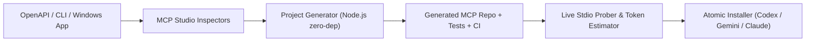

# MCP Studio

[](https://glama.ai/mcp/servers/@deusbr/mcp-studio)

[](https://github.com/deusbr/mcp-studio/actions/workflows/ci.yml)
[](LICENSE)
[](https://nodejs.org)

Zero-dependency workbench (**CLI + MCP Server + Local Web UI + portable `SKILL.md`**) that turns applications **without an official MCP server** into tested, ready-to-install **Model Context Protocol (MCP)** servers.

Works across **Codex**, **Gemini CLI**, **Claude Code**, **Claude Desktop**, and **OpenBot** with zero third-party npm dependencies.

---

## What It Converts into MCP Servers

| Target Type | How MCP Studio Builds the Bridge | Security Built-In |
| :--- | :--- | :--- |
| **OpenAPI / REST APIs** | Parses OpenAPI 3.x / Swagger 2.0 JSON into typed JSON Schema tools | Env-var auth (`BEARER_TOKEN`), timeouts, caps tool bloat (`<= 40`) |
| **Local CLI Binaries** | Inspects `--help` flags & subcommands into structured `stdio` tools | Uses `execFile` (`shell: false`) — zero shell injection |
| **Windows Desktop Apps** | Bridges apps without APIs (process status, launch, focus, hotkeys, COM for Excel/Word) | Encoded PowerShell (`-EncodedCommand`) + allowlisted hotkeys |
| **Custom HTTP / Blueprints** | Scaffolds from declarative JSON specs | Strict `additionalProperties: false` schemas |

## Architecture



Every generated MCP server ships as a complete repository:
- `bin/mcp-server.cjs` — JSON-RPC 2.0 `stdio` MCP server (`initialize`, `tools/list`, `tools/call`)
- `lib/tools.cjs` — isolated handlers (`http`, `cli`, `windows-ps`, `windows-com`)
- `tests/server.test.cjs` — runnable `node --test` handshake test suite
- `README.md`, `LICENSE`, `.gitignore`, `.github/workflows/ci.yml`

---

## Quick Start

### 1. Install MCP Studio into Codex, Gemini CLI, Claude Code & Claude Desktop

```bash
node bin/mcp-studio.cjs install
node bin/mcp-studio.cjs status
```

### 2. Launch the Local Web Workbench (`http://127.0.0.1:4325`)

```bash
node bin/mcp-studio.cjs web --port 4325
```

### 3. Generate an MCP Server via CLI

```bash
# From an OpenAPI / Swagger JSON spec
node bin/mcp-studio.cjs from-openapi --spec ./openapi.json

# From a local CLI binary (--help introspection)
node bin/mcp-studio.cjs from-cli --command git

# From a Windows desktop app preset (excel-com, word-com, vlc-http, generic-desktop)
node bin/mcp-studio.cjs from-windows --preset excel-com

# Test the generated server (node --test + live stdio probe + schema token estimate)
node bin/mcp-studio.cjs test --slug microsoft-excel-mcp

# Install the generated server into Codex, Gemini CLI, and Claude
node bin/mcp-studio.cjs install-generated --slug microsoft-excel-mcp
```

---

## MCP Server Tools (`mcp-studio`)

When registered as an MCP server, AI assistants can invoke:

- `studio_list_templates` — list target builders and Windows presets
- `studio_inspect_openapi` — parse OpenAPI/Swagger JSON into a blueprint
- `studio_inspect_cli` — inspect a local CLI safely (`execFile`)
- `studio_inspect_windows_apps` — scan active Windows GUI windows/processes
- `studio_create_project` — generate the standalone MCP server repo
- `studio_test_generated` — run `node --test`, stdio handshake, and estimate schema tokens
- `studio_install_generated` — register the generated MCP into local AI clients
- `studio_list_projects` — list generated MCP projects
- `studio_start_web` — launch/return Local Web Workbench URL (`127.0.0.1:4325`)

---

## Verification

```bash
npm run check
npm test
```

## License

[MIT](LICENSE) — Emerson Almeida (`@deusbr`)
